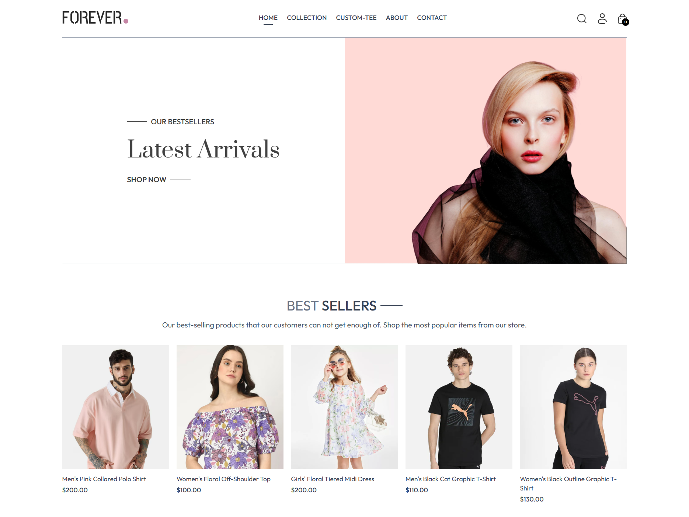

# Forever — Full-Stack E-Commerce Store

A portfolio-grade e-commerce platform built as an npm-workspace monorepo: a customer storefront, a separate admin dashboard, an Express/MongoDB API, and a shared domain package that keeps all three apps agreeing on money, carts, orders, and catalogue rules.

Unlike a UI-only store demo, Forever has real accounts, server-persisted carts, Stripe and cash-on-delivery checkout, order history, admin fulfilment, and a custom T-shirt studio where shoppers design and buy their own tee.

**Live storefront:** https://forever-frontend-one-pearl.vercel.app/  
**GitHub:** https://github.com/rjdiips  
**LinkedIn:** https://www.linkedin.com/in/rajdeep-sen-85b079189/  
**Email:** rjdiips@gmail.com

---

## Why this project is worth a look

- **Complete vertical slice.** Authentication, catalogue, cart, checkout, payments, order history, and admin order management all work end to end.
- **Server-authoritative money.** Orders are priced from the catalogue on the server in integer cents. The client sends product, size, quantity, and design intent only — a tampered price or total is ignored.
- **A non-trivial frontend feature.** The custom-tee studio is a canvas editor with drag, resize, colour switching, image downscaling, cropped export, and an upload pipeline that turns a live design into a purchasable cart line.
- **Security decisions are explicit and tested.** Purpose-scoped JWTs, token expiry, password-change revocation, timing-equal login, generic password-reset responses, and per-IP auth rate limits.
- **One domain language.** A shared ESM package owns cents, taxonomies, cart-line identity, order statuses, display order, and Tee-base rules for the storefront, admin, and API.
- **Built for serverless.** One Express entry point, a small MongoDB pool, retryable connection handling, in-memory uploads to Cloudinary, request correlation IDs, and sanitized 5xx responses.

---

## Features

### Storefront

- **Home page** — hero, bestsellers rail, latest arrivals (the last ten products in the admin-set display order), policy strip, and newsletter signup.
- **Catalogue browsing** — multi-select category filters (Men / Women / Kids), type filters (Topwear / Bottomwear / Winterwear), name search, and sorting by relevance, price low-to-high, or price high-to-low.
- **Product detail** — multi-image gallery, price, description, size picker, add-to-cart, delivery and returns information, review tab (seeded demo content), and related products from the same category and type.
- **Custom Tee studio** — design a tee, download the result, or add it straight to the cart:
  - Designs rendered on the blank image supplied by the catalogue's Tee base, so the picture, price, and sizes always match the selected colour.
  - Five preset graphics or an uploaded image, downscaled in the browser before editing.
  - Drag to position, resize with a slider, switch colours, reset, and export.
  - Export crops to the tee's visible bounds, then tries successive WebP quality levels to stay within a 500 KB budget (falling back to PNG where WebP is unavailable).
  - Uploaded designs are validated server-side and stored in Cloudinary.
  - A custom tee is a cart line identified by product + size + **design**, so two designs of the same tee and size remain separate lines.
- **Cart** — guest carts work in memory; signed-in carts persist to MongoDB and reload across sessions. Quantity updates, removal, live subtotal, delivery fee, item count badge, and custom-design previews.
- **Checkout** — delivery-address form with **Cash on Delivery** or **Stripe Checkout**. COD clears the cart immediately; Stripe clears it only after the payment is verified.
- **Order history** — every order shows its items, custom design thumbnails, size, quantity, unit price, payment method, status, and a refreshable "track order" view.
- **Accounts** — register, sign in, sign out, persist the session across reloads, and handle expiry gracefully by clearing the token and returning to login.
- **Password reset** — request a link by email, set a new password once, and get signed in automatically. Reset links are short-lived and single-use.
- **Newsletter** — subscription endpoint that sends a welcome email through Brevo (falling back to Resend), with a confetti confirmation in the UI.
- **Supporting pages** — About, Contact, footer, and newsletter calls to action.
- **Responsive UI** — mobile navigation, collapsible filters, and layouts that adapt from phone to desktop.
- **Production analytics** — Vercel Web Analytics, proxied through `/va` in production so ad blockers do not match the default insights URL.

### Admin dashboard

- **Separate admin app** with its own login and session handling.
- **Product creation** — name, description, category, sub-category, price, sizes, bestseller flag, up to four images, and an optional **Custom Tee base** with a colour.
- **Product management** — list every product, remove one, and move products up or down to set the storefront display order. The order is persisted as each product's `position`, so the admin and storefront agree.
- **Order management** — view every order with customer and address details, item list, custom-design previews, payment method, payment state, order amount, and date.
- **Fulfilment workflow** — move an order through Order Placed → Packing → Shipped → Out for Delivery → Delivered from a status dropdown.
- **Session expiry handling** — a 401 interceptor clears the admin token and returns to the login screen with a clear message.

### Platform and engineering

- **Shared domain package** — `@forever/shared` is plain ESM with JSDoc and no build step. It is imported by the storefront, admin, and API so rules cannot drift.
- **Money in integer cents** — `toCents`, `fromCents`, and `formatMoney` are the only conversions; currency is USD. Legacy orders stored in dollars are still read correctly through a pricing-version helper.
- **Server-side order pricing** — the API loads products, validates size, quantity, and design, computes subtotal and delivery, and stores the final amount. Stripe sessions are built from those same server-side numbers.
- **Purpose-scoped auth tokens** — storefront session tokens, admin session tokens, and password-reset tokens cannot be replayed as one another. Session tokens live 7 days, admin tokens 12 hours, reset tokens 30 minutes.
- **Token revocation without a session store** — `User.tokenVersion` is embedded in tokens; changing the password bumps it, revoking every old session token and outstanding reset link at once.
- **Defensive auth** — bcrypt hashing, a dummy-hash comparison so unknown emails take the same time as wrong passwords, generic password-reset confirmations, and rate limits on login, registration, admin login, forgot-password, and reset-password.
- **Validated uploads** — product and design images are buffered in memory and streamed to Cloudinary. Designs must be WebP/PNG/JPEG, at most 2 MB, attached to a Tee base, and referenced by an http(s) URL.
- **Serverless-aware API** — cached MongoDB connection attempts with retry, a pool size of five, a 503 response while the database is unreachable, request IDs, and generic messages for 5xx errors.

---

## Tech stack

| Area | Stack |
| --- | --- |
| Storefront & admin | React 19, Vite 6, Tailwind CSS 4, React Router 7, Context API, Axios, React Toastify |
| API | Node.js, Express 4, Mongoose 8, JWT, bcrypt, express-rate-limit, Multer, validator |
| Data & services | MongoDB Atlas, Cloudinary, Stripe Checkout, Resend |
| Shared domain | `@forever/shared` — plain ESM, JSDoc, Node's built-in test runner |
| Testing | Node `node:test` (shared + API), Vitest (storefront), ESLint |
| Deployment | Three Vercel projects (storefront, admin, API function), Vercel Web Analytics |

---

## Architecture

```text
Storefront (React/Vite) ──┐
Admin (React/Vite) ───────┼──► Express API ──► MongoDB Atlas
                          │        │
                          │        ├──► Cloudinary  (product images + tee designs)
                          │        ├──► Stripe      (card checkout)
                          │        └──► Brevo/Resend (password reset + newsletter)
                          │
                          └── @forever/shared  (imported by all three apps)
```

The repository is a single npm workspace. `shared`, `frontend`, `admin`, and `backend` install from the repository root, which lets Vercel deploy each app independently while skipping builds for unaffected projects.

### Design decisions that shaped the code

- **The API is the source of truth for an order.** `backend/lib/orderPricing.js` prices every line from MongoDB, rejects unknown products, unavailable sizes, bad quantities, design-less Tee bases, and designs attached to ordinary products. The checkout request carries intent only.
- **Auth is stateless but revocable.** `backend/lib/authTokens.js` owns all signing, verification, purposes, and lifetimes. `backend/controllers/userController.js` implements atomic, single-use password resets by conditioning the update on the current `tokenVersion`.
- **The shared package is the anti-drift layer.** `shared/src/` defines the taxonomy, cart-line identity and merging, order statuses, display order, Tee colours and base resolution, and money conversion.
- **Uploads never touch disk.** Multer memory storage streams directly to Cloudinary, avoiding temp-file collisions and cleanup on a serverless host.
- **Failures have one shape.** Every route returns `{ success, message?, data? }`; expected errors carry a status, while 5xx errors are logged with a request ID and returned as a generic message.

---

## API overview

All endpoints live under `/api`. Authenticated requests send the session token in the `token` header.

| Area | Endpoints |
| --- | --- |
| Auth | `POST /user/register`, `/user/login`, `/user/admin`, `/user/forgot-password`, `/user/reset-password` |
| Products | `GET /product/list`, `POST /product/single`, `/product/add`, `/product/remove`, `/product/reorder` |
| Cart | `POST /cart/add`, `/cart/update`, `/cart/get` |
| Orders | `POST /order/place` (COD), `/order/stripe`, `/order/verifyStripe`, `/order/userorders` |
| Admin orders | `POST /order/list`, `/order/status` |
| Designs | `POST /design/upload` |
| Newsletter | `POST /subscribe` |

Admin-only product and order routes are protected by the admin token middleware; storefront cart, order, and design routes require a user session token.

---

## Project structure

```text
Forever_Ecommerce/
├── frontend/                  # Customer storefront (React + Vite)
│   └── src/
│       ├── Pages/             # Home, Collection, Product, Cart, PlaceOrder, Orders, Login, etc.
│       ├── Components/        # Navbar, product cards, cart totals, tee canvas and controls
│       ├── auth/              # Session context and expiry handling
│       ├── cart/              # Cart context, line math, server sync
│       ├── catalogue/         # Product fetching, search, related products
│       ├── tee/               # Editor state, geometry, export, upload, purchase rules
│       ├── reviews/           # Deterministic demo review content
│       └── config.js          # Validated VITE_BACKEND_URL
│
├── admin/                     # Admin dashboard (React + Vite)
│   └── src/
│       ├── Pages/             # Add product, product list, orders
│       ├── Components/        # Admin login, navbar, sidebar
│       └── auth/              # Admin session context and 401 handling
│
├── backend/                   # Express API (Node.js)
│   ├── config/                # MongoDB, Cloudinary, Stripe, frontend URL
│   ├── controllers/           # User, product, cart, order, design, subscriber handlers
│   ├── middlewares/           # Auth, rate limiting, database connection, uploads, logging
│   ├── models/                # User, Product, Order schemas
│   ├── routes/                # API route definitions
│   ├── lib/                   # Pricing, order intake, auth tokens, email, HTTP envelope
│   └── app.js                 # Single Express entry, exported for Vercel
│
├── shared/                    # @forever/shared domain package
│   └── src/                   # Money, cart, orders, product rules, taxonomy, config
│
├── homepage.png               # Storefront screenshot
└── package.json               # npm workspaces + root test script
```

---

## Getting started

### Prerequisites

- Node.js 20+ and npm 10+
- A MongoDB Atlas connection string
- Optional: Cloudinary, Stripe, and Resend accounts for uploads, card payments, and email

### 1. Clone and install

Install once at the repository root; npm installs all four workspaces.

```bash
git clone https://github.com/rjdiips/Forever_Ecommerce.git
cd Forever_Ecommerce
npm install
```

### 2. Configure the API

Create `backend/.env`:

| Variable | Required | Purpose |
| --- | --- | --- |
| `ATLASDB_URI` | Yes | MongoDB Atlas connection string |
| `JWT_SECRET` | Yes | Signs session, admin, and password-reset tokens |
| `FRONTEND_URL` | Yes | Storefront origin used in password-reset links, e.g. `http://localhost:5173` |
| `ADMIN_EMAIL` | Yes, for admin | Admin login email |
| `ADMIN_PASSWORD` | Yes, for admin | Admin login password |
| `CLOUDINARY_CLOUD_NAME` | Yes, for uploads | Cloudinary cloud name |
| `CLOUDINARY_API_KEY` | Yes, for uploads | Cloudinary API key |
| `CLOUDINARY_API_SECRET` | Yes, for uploads | Cloudinary API secret |
| `STRIPE_SECRET_KEY` | Yes, for card checkout | Stripe secret key |
| `BREVO_API_KEY` | Optional | Preferred email provider: sends password-reset and newsletter emails |
| `BREVO_FROM_EMAIL` | With `BREVO_API_KEY` | Sender address verified in Brevo; a single verified address needs no domain |
| `BREVO_FROM_NAME` | Optional | Sender display name for Brevo, defaults to `Forever` |
| `RESEND_API_KEY` | Optional | Fallback email provider, used when `BREVO_API_KEY` is unset |
| `RESEND_FROM_EMAIL` | Optional | Verified Resend sender; falls back to `onboarding@resend.dev`, which only delivers to the account owner |
| `PORT` | Optional | API port, defaults to `4000` |

The API refuses to start without `FRONTEND_URL`, so it can never email a broken reset link. Email needs `BREVO_API_KEY` plus `BREVO_FROM_EMAIL`, or `RESEND_API_KEY`; without either, sending is disabled and the server still starts.

### 3. Configure the frontend apps

Create `frontend/.env` and `admin/.env`:

```dotenv
VITE_BACKEND_URL=http://localhost:4000
```

Both apps validate this value at startup and fail with a clear message if it is missing.

### 4. Run locally

Use three terminals from the repository root:

```bash
npm run server -w backend   # API on http://localhost:4000
npm run dev -w frontend     # Storefront on http://localhost:5173
npm run dev -w admin        # Admin on http://localhost:5174
```

The admin app signs in with the `ADMIN_EMAIL` and `ADMIN_PASSWORD` values from `backend/.env`.

### 5. Production builds

```bash
npm run build -w frontend
npm run build -w admin
npm start -w backend
```

---

## Testing and quality

```bash
npm test                 # Runs every workspace that defines tests
npm run lint -w frontend
npm run lint -w admin
```

- The API and shared package use Node's built-in `node:test` runner.
- The storefront uses Vitest.
- There are 40+ test files covering order pricing and money conversion, auth token purposes and expiry, password-reset single use and revocation, rate limiting, cart merging and line identity, catalogue display order, related-product selection, session expiry, and tee geometry, export budget, upload downscaling, and purchase readiness.

The test suites deliberately focus on pure domain logic and seams: pricing, token rules, cart math, and canvas/export helpers are testable without MongoDB, Stripe, Cloudinary, or a browser canvas.

---

## Code tour

If you are reviewing the repository, these are the most interesting places to start:

- **Pricing and checkout:** [`backend/lib/orderPricing.js`](backend/lib/orderPricing.js) and [`backend/lib/orderIntake.js`](backend/lib/orderIntake.js) — server-priced orders, Stripe session creation, and payment verification.
- **Authentication and reset flow:** [`backend/lib/authTokens.js`](backend/lib/authTokens.js) and [`backend/controllers/userController.js`](backend/controllers/userController.js) — token purposes, versioned revocation, timing-equal login, and atomic resets.
- **Custom tee studio:** [`frontend/src/tee/`](frontend/src/tee/) and [`frontend/src/Components/TshirtCanvas.jsx`](frontend/src/Components/TshirtCanvas.jsx) — editor state, canvas geometry, cropping, encoding budget, and upload.
- **Shared domain rules:** [`shared/src/`](shared/src/) — the single definition of money, cart lines, catalogue order, order statuses, and Tee bases.
- **Catalogue and cart state:** [`frontend/src/catalogue/CatalogueContext.jsx`](frontend/src/catalogue/CatalogueContext.jsx) and [`frontend/src/cart/CartContext.jsx`](frontend/src/cart/CartContext.jsx) — one source of product data and a cart that stays in sync with the server.

---

## Screenshots



---

## Known limitations and next steps

- **Reviews are demo content.** The product reviews and the star summary are deterministic seeded data, not a review backend.
- **Stripe confirmation happens on redirect.** The API verifies the Checkout session before marking an order paid. A production hardening step would add a Stripe webhook for asynchronous confirmation and replay protection.
- **One admin identity.** Admin access uses a single email/password from environment variables rather than a role-based admin user system.
- **No inventory tracking.** Products have sizes and availability rules, but no stock counts or oversell protection.
- **Rate limits are per instance.** The in-memory store is best-effort on serverless and resets on cold starts; a shared Redis store would make it durable.
- **Product editing is limited.** Admins can add, remove, and reorder products, but not edit an existing product in place.

---

## Contributing

Issues, suggestions, and pull requests are welcome. If you spot a bug or want to discuss an improvement, open an issue on the repository.

Built by [@rjdiips](https://github.com/rjdiips).
